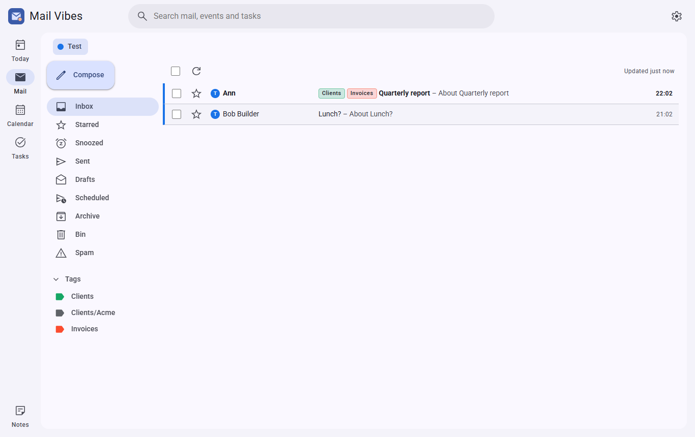
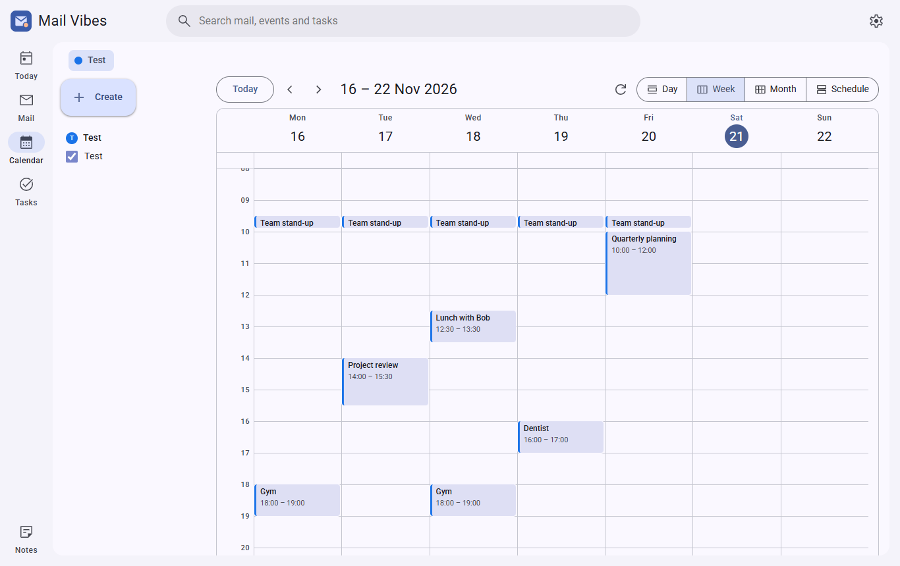

# Mail Vibes

A free, open-source web app that brings several Google accounts and Microsoft 365 organisations
together in one place: **mail, calendar, tasks and contacts**, with a Material 3 look, in English
and Italian. It can also show other mailboxes over IMAP, including Italian **PEC** (certified
email).

It runs entirely in your browser. There is no server and no Mail Vibes account: your browser
talks straight to Google and Microsoft (and, for IMAP mailboxes, to your own small bridge).

**Try it:** <https://camillopatricelli.github.io/mail-vibes/>



## No warranty, no responsibility for your data

Mail Vibes is a personal, free, open-source project provided as is, without warranty of any kind
(see [LICENSE](LICENSE)). It has no server: your mail, events, tasks and contacts go directly
between your browser and Google or Microsoft, and are never sent to or seen by the author. You use
it at your own risk and are responsible for your accounts, your data and your organisation's
policies. If your organisation uses it, its administrators decide whether to allow it.

## What it does

- **Accounts:** any number of Google accounts and Microsoft 365 work or school accounts, each
  with its own colour. Views can show every account together or one at a time.
- **IMAP and PEC mailboxes** (mail only): a hosting provider's mailbox, a self-hosted server or a
  PEC mailbox, with folders, search, tags, snooze, send later, drafts and rules. PEC messages are
  shown as the original message with their certification details, receipts are grouped with the
  message they are about, and they can be forwarded as normal email from another account. See
  [docs/imap-accounts.md](docs/imap-accounts.md).
- **Today:** the day's events, tasks that are due or overdue, and unread mail at a glance.
- **Mail:** inbox, folders and Gmail labels; threads; reply, forward, drafts and attachments
  (PDFs and images open in the app); snooze and send later; tags (Gmail labels and Outlook
  categories); recipient suggestions from your contacts.
- **Mail rules:** mark as read, archive, move or delete new messages by sender or by words they
  contain. They are saved as Gmail filters and Outlook rules, so Google and Microsoft run them
  even when Mail Vibes is closed. IMAP accounts have no server rules: Mail Vibes runs theirs while
  it is open.
- **Calendar:** day, week, month and agenda views; create and edit events with guests, a
  location (with optional Google Maps suggestions), Google Meet or Teams links, repeat rules
  and several reminders, including days ahead.
- **Tasks:** Google Tasks and Microsoft To Do, with start and due dates, a reminder and a repeat
  rule.
- **Search** across mail, events and tasks.
- **Notifications** for new mail, event reminders and task reminders while the app is open.
- **Installable** as an app on computers and phones (PWA), with light and dark themes.
- **Copy to another device:** one encrypted link (and a short code) sets up a phone, tablet or
  other computer just like this one, IMAP passwords included. A settings file is also available as
  a backup.
- **Unread filter** in every mail folder.



## How it works, and what is stored

There is no backend. The app is a static single-page app hosted on GitHub Pages. Your browser
signs in with Google and Microsoft and uses their own APIs (Gmail, Google Calendar, Google Tasks,
People and Microsoft Graph).

IMAP mailboxes are the exception, because browsers can't speak IMAP or SMTP: they go through a
**bridge** you deploy yourself, for free, on your own Cloudflare account
([docs/imap-bridge.md](docs/imap-bridge.md)). It only relays encrypted connections between your
browser and your mail server, stores and logs nothing, and accepts only your access key. Reading,
writing and understanding mail still happen in your browser. The encryption to the mail server
ends inside the bridge, which is why it should be your own.

- Mail, events, tasks and contacts are held **in memory only** and are never saved on the device.
- Saved in the browser: your settings (account colours, preferences, default accounts, IMAP
  server names and rules), the Microsoft sign-in cache, folded sidebar groups and the list of
  reminders already shown.
- IMAP passwords are kept in memory only, unless you choose to remember one on the device: then
  it is stored encrypted with a key the browser never reveals. Passwords are never in the
  settings or the settings export file.
- Google sign-ins are kept in memory only, so Google asks you to sign in again after the page is
  reloaded, and every hour. If your bridge holds the Google client secret, it makes long-lasting
  sign-ins instead: those are stored on the device, encrypted like remembered IMAP passwords, and
  renewed without clicks ([docs/imap-bridge.md](docs/imap-bridge.md#long-lasting-google-sign-ins-optional)).
- The app writes to your own accounts only what you ask for. It also uses a few
  `Mail Vibes/…` labels for snooze and send later in Gmail (folders under `Mail Vibes` in IMAP
  mailboxes), and a `Mail Vibes:` line in the notes of Google tasks that have a start date, a
  reminder or a repeat rule.
- The page has a strict Content Security Policy: it can send requests only to Google, Microsoft
  and Cloudflare Workers (where your bridge runs). Pictures from the web inside emails stay blocked until you choose to show them.

The **Privacy** page in the app has the full details.

## Getting started

To use the hosted app you need sign-in apps ("app registrations") that allow it:

- **Google accounts** need an OAuth client from a Google Cloud project. The hosted app has one,
  but Google only lets in the users added as testers until the project is verified. See
  [docs/google-setup.md](docs/google-setup.md) to create your own.
- **Microsoft 365 organisations** each need their own app registration in Microsoft Entra. The
  app ships with none built in. See [docs/microsoft-setup.md](docs/microsoft-setup.md).
- **Google Maps place suggestions** are optional and use your own API key. See
  [docs/google-maps-key.md](docs/google-maps-key.md).
- **IMAP and PEC mailboxes** need your own bridge
  ([docs/imap-bridge.md](docs/imap-bridge.md)), then Settings → Add IMAP account
  ([docs/imap-accounts.md](docs/imap-accounts.md)).
- **Other devices:** see [docs/other-devices.md](docs/other-devices.md).

### Sharing a Microsoft 365 organisation

An organisation's administrator can share its app registration with users in one of three ways:

- **Setup link:** in Settings → Microsoft 365 organisations, the link button copies a URL such as
  `https://<host>/mail-vibes/#/setup/org/<code>`. Opening it asks the user to confirm adding the
  organisation.
- **Settings file:** Settings → Back up settings → Export, then the user imports the file.
- **Manually:** Settings → Add organisation (name, application/client ID, directory/tenant ID).

These contain only public identifiers, never secrets.

## Hosting your own copy

You can run your own copy, with your own sign-in apps, on GitHub Pages or any static web host.

1. Fork this repository.
2. Create a Google OAuth client ([docs/google-setup.md](docs/google-setup.md)) and, if you need
   one, a Microsoft app registration ([docs/microsoft-setup.md](docs/microsoft-setup.md)). Use
   your own site's address in both.
3. In your fork, open **Settings → Secrets and variables → Actions → Variables** and add
   `VITE_GOOGLE_CLIENT_ID` with your Google client ID.
4. In **Settings → Pages**, set the source to **GitHub Actions**. Every push to `main` then runs
   the tests, builds the app and publishes it.

The build serves the app from `/mail-vibes/`. If your fork or host uses another path, set
`VITE_BASE` (for example `VITE_BASE=/` for a site at the root of a domain). On another host,
run `npm run build` and upload the `dist` folder.

To build Microsoft 365 organisations into your copy, set `VITE_MS_TENANTS` (see
[.env.example](.env.example)). Users can also add them in Settings, as above.

## Limitations

- Google sign-ins last one hour and end when the page is reloaded, unless a bridge with the
  Google client secret makes them long-lasting.
- Notifications only arrive while the app is open in a tab or as an installed app.
- Microsoft 365 needs an app registration in each organisation, and its administrator may need to
  approve it.
- IMAP mailboxes need a bridge you deploy yourself, have mail only (no calendar, tasks or
  contacts), and their rules and scheduled messages run only while Mail Vibes is open. On PEC
  mailboxes, search looks only at the subject and sender. See
  [docs/imap-accounts.md](docs/imap-accounts.md).
- Outlook events allow one reminder; Google Calendar allows up to five.
- Google Tasks has no start date, reminder or repeat fields: Mail Vibes keeps them in the task's
  notes and creates the next task itself when a repeating one is done.

## Development

```sh
npm install
npm run dev      # http://localhost:5173
npm test
npm run build
```

For local development, copy `.env.example` to `.env.local` (git-ignored) and fill in your own
app registrations. Add `http://localhost:5173` as an origin and redirect address in both.

On Windows, run commands from a path with an upper-case drive letter (`C:\...`); Vitest fails to
start from `c:\...`.

Built with React, TypeScript, Vite, TanStack Query, Zustand, i18next, MSAL and Google Identity
Services.

## Licence

MIT. Icons are Material Symbols (Apache-2.0). Roboto font (Apache-2.0 / OFL) via Fontsource.
